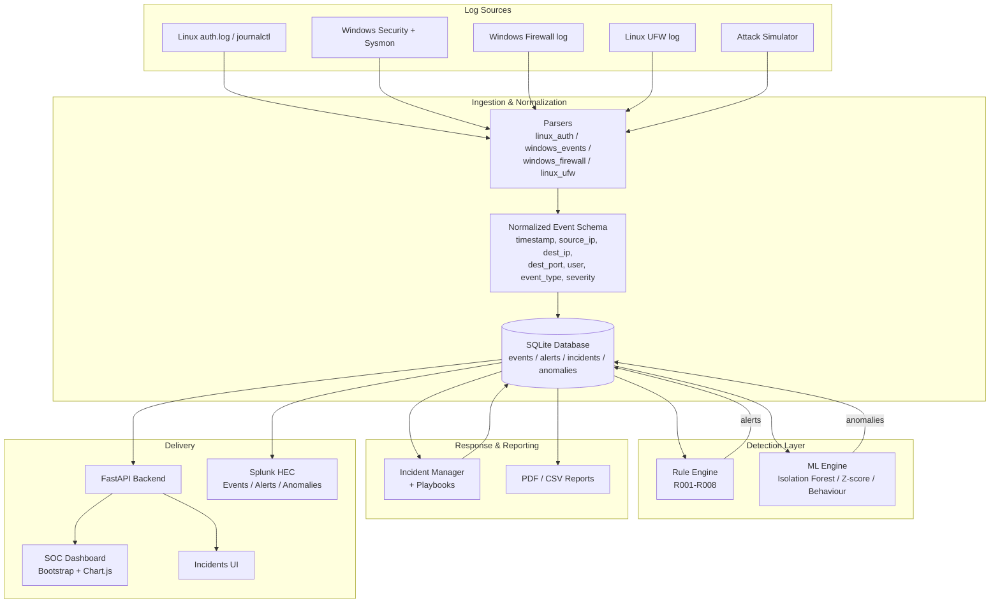

# System Architecture

## Data flow summary

1. **Collection** - Logs arrive from Linux auth, Windows Event Log/Sysmon, Windows Firewall, Linux UFW, or the built-in attack simulator.
2. **Normalization** - Each source has its own parser, but every parser outputs the same event schema (`parsers/schema.py`), so downstream code never needs to know where an event came from.
3. **Storage** - Events are deduplicated by content hash and stored in SQLite (`database/db.py`).
4. **Detection** - Two independent engines run over the same event store:
   - **Rules** (`detection/rules.py`, `detection/network_rules.py`) produce confirmed, explainable alerts (R001-R008).
   - **ML** (`ml_engine/`) produces statistical anomaly predictions (Isolation Forest, Z-score, behaviour profiling), kept in a separate table and capped below `critical` severity.
5. **Response** - Each alert becomes a tracked incident (`incident_response/`) with a playbook: classification, containment steps, and an investigation checklist.
6. **Delivery** - A FastAPI backend (`app.py`) serves a dark-themed dashboard and incident-management UI, exports PDF/CSV reports, and forwards everything to Splunk via HEC for SPL search and alerting.
